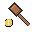

# Auction: a Bot Party mod

A game mode for [Bot Party](https://github.com/AnCarsenat/bot-party)'s party
mode, where everyone has a level of their own and money to spend.

## How it plays

1. **Everyone starts with 100 coins and a random level** (one of the arenas,
   your own maps included).
2. **The auction room.** The round's items are sold one at a time. **Up /
   Down** set the price you'd pay (**Left / Right**: 10 at a time), **Jump**
   bids it. A bid has to beat the highest one by at least 1 coin. The clock
   runs for each item, and a bid with less than 5 seconds left adds 5 seconds.
   When the clock runs out, the highest bidder pays and gets the item.
3. **The levels, one after another.** The owner traps their level with what
   they bought (items stay from round to round), then the others race through
   it while the owner watches.
4. **The bank pays:**
   - reaching the flag of someone else's level: 20 coins;
   - every robot that doesn't make it through your level: 10 coins for you;
   - nobody makes it through a level: 10 coins for everyone.
5. **The end:** the most coins after 3 rounds, or the first to 300 coins.

Every number is a rule: **Party → Rules** with Auction as the mode (start
coins, items per auction, bid time, what each thing pays, how the party ends).
Bots bid and trap too.

## Install

In the game: **Mods → Explore → Auction**. Or download `auction.pck` from the
[latest release](../../releases/latest) and put it in the game's mods folder
(**Mods → Open mods folder**), then switch it on in **Mods**. Online, the host
sends the mod to players who don't have it.

Needs Bot Party v0.37 or later (per-mode rules and modes that run the party
themselves).

## How it works

- `auction.gd` extends the game's `PartyMode` with `custom_flow = true`: it sets
  up the party (`party_started`), gives each level's owner their items to place
  (`start_level`), pays the coins (`score_round`) and moves on to the next level
  or auction (`after_score`). Its rules come from `rule_defs()`.
- `auction_room.gd` / `auction_room.tscn` is the auction room, drawn in code.
  Online, the host runs it and sends its state to the others.

See [MODDING.md](https://github.com/AnCarsenat/bot-party/blob/main/MODDING.md#game-modes).

Releases are made by GitHub Actions: raise `version` in `mod.json`, then
`git tag v2.1 && git push origin v2.1`.

## License

[GNU GPL version 3](LICENSE), like Bot Party's code.
